<!-- ===================== HEADER BANNER ===================== -->
<div align="center">



<!-- ===================== TYPING INTRO ===================== -->
<a href="https://git.io/typing-svg">
  
</a>

<br/>


</div>

---

## 👨‍💻 About Me

```js
const sasanka = {
  name: "Sasanka Gayathra",
  username: "sasanka2023",
  location: "Galle, Sri Lanka 🇱🇰",
  company: "@TechsenseLK",
  currentlyLearning: ["System Design", "Cloud & DevOps", "Spring Boot"],
  funFact: "I turn coffee into code ☕ → 💻",
  lookingFor: "Cool projects and great people to build with 🤝",
};
```

- 🔭 Working on **Student LMS** and other full stack projects
- 🌱 Currently sharpening my skills in backend architecture and clean code
- 💬 Ask me about **React, Node.js, C#, .NET, Java and Spring**
- ⚡ I enjoy turning real-world problems into working software

---

## 🛠️ Tech Stack

<div align="center">

**Languages**


**Frameworks & Libraries**


**Databases & Tools**


</div>

---

## 📊 GitHub Stats

<div align="center">


<br/>


</div>

---

## 🐍 Contribution Snake

<div align="center">

<picture>
  <source media="(prefers-color-scheme: dark)" srcset="https://raw.githubusercontent.com/sasanka2023/sasanka2023/output/github-snake-dark.svg" />
  <source media="(prefers-color-scheme: light)" srcset="https://raw.githubusercontent.com/sasanka2023/sasanka2023/output/github-snake.svg" />
  
</picture>

</div>

---

## 🤝 Let's Connect

<div align="center">

<a href="https://www.linkedin.com/in/sasanka-gayathra-961764229">
  
</a>
<a href="mailto:pabasaragayathra@gmail.com">
  
</a>
<a href="https://github.com/TechsenseLK">
  
</a>

<br/><br/>


⭐ *If you like what you see, drop a star on my repos!* ⭐

</div>
